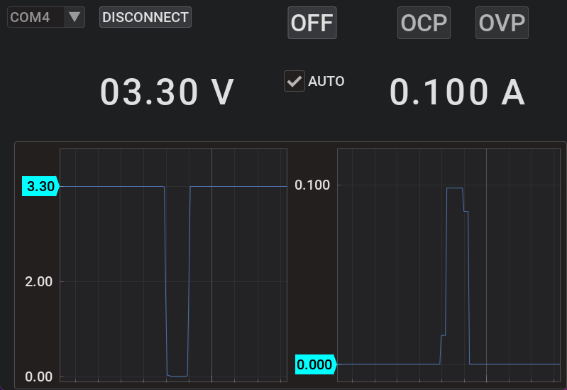

# koradGui

kordGui is opinionated and not very creatively named GUI app for controlling Korad bench power supplies.

It should be compatible with all KA3xxxP, but has been tested only with KA3005P.

Also has support for the FNIRSI DPS-150.

The device selector detects Korad USB `0416:5011` and FNIRSI
USB `2e3c:5740`. Differentiates them by yellow **K** and red **F**.
Neither protocol is sent to unrelated serial ports.


> [!CAUTION]
> This program directly affects the circuit connected to the controlled power supply and can cause damage.
>** Use at your own risk.**




# Details

GUI is built with Dear ImGui via imgui_bundle bindings.

Distribution is a **single-file AppImage** built with cx-Freeze
(`bdist_appimage`). To build locally:

```bash
uv sync
uv run python setup.py bdist_appimage   # -> dist/koradgui-*.AppImage
uv run python setup.py build_exe        # -> build/exe.*/koradGui (directory build)
```

A GitHub Actions workflow (`.github/workflows/build.yml`) builds the AppImage
in a manylinux_2_28 container (works on any distro with glibc >= 2.28), smoke
tests it headlessly and attaches it to `v*` tag releases.

Run the automated suite (no serial ports are opened):

```bash
uv run python -m unittest discover -s tests -v
```

Tests include headless Dear ImGui frames at 800×550, checking that the empty,
Korad, and FNIRSI protection areas leave the other widgets at the same positions.
The older `koradgui/control_test.py` is a manual hardware script, not part of
this automated suite.

